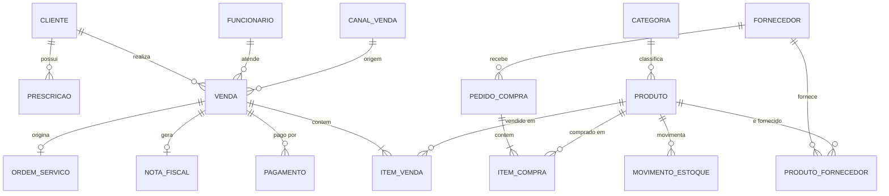

# Projeto Integrador – Sistema Integrado para a Óptica Monte Alegre

**Curso:** Análise e Desenvolvimento de Sistemas
**Proposta da consultoria de tecnologia**

---

## 1. Engenharia de Requisitos

### 1.1 Requisitos Funcionais (RF)

| Cód. | Requisito | Descrição |
|---|---|---|
| RF01 | **CRM – cadastro de clientes** | Registrar dados pessoais, contatos, consentimento LGPD, **prescrição oftalmológica** (grau, DP, receita anexa), histórico de compras e preferências. |
| RF02 | **Pós-venda e relacionamento** | Lembretes automáticos de revisão de grau (ex.: 12 meses), aniversários e retirada de óculos prontos, por WhatsApp/e-mail. |
| RF03 | **Controle de estoque** | Entradas e saídas de armações, lentes, acessórios e lentes de contato, com alerta de estoque mínimo, inventário e rastreio por SKU. |
| RF04 | **Fornecedores e compras** | Cadastro de fornecedores, pedidos de compra, prazos, preços, condições de pagamento e histórico de entregas. |
| RF05 | **Ordem de serviço (OS)** | Acompanhar o pedido do óculos: venda → envio ao laboratório → montagem → pronto → entregue. |
| RF06 | **Vendas (PDV) e emissão fiscal** | Registro digital da venda, múltiplas formas de pagamento, parcelamento, emissão de NF-e/NFC-e integrada à SEFAZ, substituindo a nota em papel. |
| RF07 | **Relatórios gerenciais** | Vendas por período/vendedor, produtos mais vendidos, clientes mais ativos, margem, giro de estoque e ranking de fornecedores, com exportação CSV/PDF. |
| RF08 | **Controle de acesso por perfil** | Perfis (administrador, vendedor, estoquista, financeiro) com permissões distintas. |
| RF09 | **Preparação para e-commerce** | API REST documentada que exponha catálogo, estoque, pedidos e pagamentos, permitindo a loja virtual futura sem retrabalho. |

### 1.2 Requisitos Não Funcionais (RNF)

| Cód. | Categoria | Requisito |
|---|---|---|
| RNF01 | **Segurança / LGPD** | Criptografia em trânsito (HTTPS/TLS) e em repouso para dados sensíveis (prescrições); autenticação forte; logs de auditoria; consentimento e direito de exclusão. |
| RNF02 | **Disponibilidade** | Disponibilidade ≥ 99% no horário comercial, com backup diário e plano de recuperação. |
| RNF03 | **Desempenho** | Consultas de cliente/produto em menos de 2 s; emissão fiscal em menos de 5 s. |
| RNF04 | **Escalabilidade** | Suportar crescimento de clientes, produtos e novo canal online sem reescrever o sistema. |
| RNF05 | **Usabilidade** | Interface simples, treinável em poucas horas para equipe sem perfil técnico. |
| RNF06 | **Portabilidade** | Aplicação web responsiva, acessível por desktop, tablet e celular, sem instalação local. |
| RNF07 | **Manutenibilidade** | Código modular, testado e documentado; arquitetura em camadas. |
| RNF08 | **Conformidade fiscal** | Atender à legislação tributária vigente (NF-e/NFC-e, SPED) e se adaptar a mudanças. |
| RNF09 | **Interoperabilidade** | Integração com gateways de pagamento (Pix, cartão), transportadoras e emissor fiscal. |

### 1.3 Justificativa e impacto no sucesso ou fracasso

- **RF01/RF02 (CRM e pós-venda):** o diferencial da ótica é o atendimento personalizado. Os grandes varejistas ganham no preço, então a empresa precisa vencer em relacionamento. Sem esse módulo, o sistema vira apenas um caixa digital e o negócio perde sua vantagem competitiva.
- **RF03/RF04 (estoque e fornecedores):** hoje o controle é em planilhas, com risco de ruptura e de capital parado. Um estoque confiável é a base das decisões de compra e da futura loja virtual, que não pode vender o que não existe.
- **RF06 (venda e fiscal):** é o requisito legal e financeiro. Um erro fiscal gera multa. A integração elimina a duplicidade de digitação.
- **RF07 (relatórios):** é a dor central do caso, a falta de dados para decidir. Sem ele, o investimento não se traduz em retorno estratégico.
- **RF09 (API):** definir a API desde o início evita refazer a arquitetura quando o e-commerce chegar.
- **RNF01 (segurança/LGPD):** a prescrição é dado pessoal sensível (saúde). Um vazamento traria sanções da ANPD, dano reputacional e perda da confiança construída em 20 anos.
- **RNF05 (usabilidade):** os usuários não são técnicos. O principal motivo de fracasso de sistemas internos é a rejeição da equipe, que volta às planilhas.
- **RNF02/RNF04:** indisponibilidade em horário de venda gera prejuízo direto. A escalabilidade protege o investimento.

**Priorização (MoSCoW):** *Must* – RF01, RF03, RF06, RF07, RNF01, RNF05. *Should* – RF02, RF04, RF05, RF08. *Could* – exportações avançadas. *Won't (agora)* – loja virtual completa, mas com a API (RF09) já preparada.

---

## 2. Gestão de Projetos

### 2.1 Comparativo: Cascata × Scrum

| Critério | Cascata (PMBOK tradicional) | Scrum (ágil) |
|---|---|---|
| **Clareza dos requisitos** | Exige requisitos fechados no início. Funciona se forem estáveis. | Tolera requisitos que evoluem e se refinam a cada sprint. |
| **Flexibilidade a mudanças** | Baixa. Mudança tardia é cara. | Alta. Mudanças entram no backlog e são priorizadas. |
| **Participação dos stakeholders** | Concentrada no início e no fim (aceite). | Contínua. Há revisão a cada sprint, com feedback real. |
| **Entrega de valor** | Única, ao final (risco de "grande surpresa"). | Incremental e frequente, com valor percebido cedo. |
| **Riscos** | Descoberta tardia de erros de entendimento. | Escopo difuso se o Product Owner for fraco. Exige disciplina. |
| **Previsibilidade de custo/prazo** | Maior no papel, menor na prática se o escopo mudar. | Previsão por velocidade; escopo variável e orçamento controlado por sprints. |
| **Documentação** | Extensa e formal. | Enxuta, mas suficiente. |

### 2.2 Recomendação: abordagem **híbrida com base em Scrum**

O projeto tem três características que pesam a favor da agilidade:
1. **Os sócios não têm conhecimento técnico.** Eles não saberão especificar tudo de antemão. Ao ver o sistema funcionando, perceberão o que realmente precisam. O planejamento detalhado do cascata não elimina essa incerteza.
2. **Há expansão futura (e-commerce).** O escopo vai mudar, e as entregas iterativas permitem ajustar o rumo.
3. **Há necessidade de resultado rápido.** A concorrência já avança, e entregar o módulo de vendas e estoque em poucas semanas gera valor logo.

Ao mesmo tempo, o planejamento tradicional é útil em duas frentes: **orçamento e cronograma macro** (os sócios precisam de previsibilidade financeira) e **requisitos fiscais** (que são rígidos). Por isso, a proposta é:

- **Fase 0 (2–3 semanas):** levantamento, visão do produto, backlog inicial, arquitetura e orçamento macro, com uma EAP de alto nível (elemento tradicional).
- **Sprints de 2 semanas** com o Scrum: Product Owner (sócio), Scrum Master e time de desenvolvimento.
- **Cerimônias:** planejamento, daily, review com demonstração aos sócios, retrospectiva.
- **Kanban** no suporte e pós-implantação, para fluxo contínuo de pequenas demandas.
- **Roadmap de releases:**
  - Release 1 – MVP: clientes, estoque, vendas e fiscal.
  - Release 2 – fornecedores, OS, relatórios e pós-venda.
  - Release 3 – API e e-commerce.
- **Gestão de riscos:** matriz de riscos (probabilidade × impacto) revisada a cada sprint. Exemplos: resistência da equipe (mitigação: treinamento e envolvimento), migração das planilhas (mitigação: carga de dados validada), mudança fiscal (mitigação: módulo fiscal isolado).
- **Indicadores:** velocidade, burndown, bugs em produção e satisfação dos usuários.

---

## 3. Banco de Dados

### 3.1 Escolha
**Banco relacional (PostgreSQL)**. O domínio é transacional (vendas, estoque, financeiro) e exige **ACID**, integridade referencial e consultas analíticas em SQL. Dados flexíveis (por exemplo, atributos variáveis de produtos) podem usar o tipo `JSONB` do próprio PostgreSQL.

### 3.2 Modelo conceitual simplificado

### 3.3 Tabelas e campos essenciais

| Tabela | Campos principais |
|---|---|
| **cliente** | id (PK), nome, cpf (único), data_nascimento, telefone, email, endereço, consentimento_lgpd, data_consentimento, criado_em |
| **prescricao** | id (PK), cliente_id (FK), data_receita, médico/CRM, esfera_od/oe, cilindro_od/oe, eixo_od/oe, adição, dp, validade, arquivo_receita |
| **funcionario** | id (PK), nome, perfil, email, senha_hash, ativo |
| **categoria** | id (PK), nome (armação, lente, solar, acessório...) |
| **produto** | id (PK), sku (único), descrição, categoria_id (FK), marca, preço_custo, preço_venda, estoque_minimo, atributos (JSONB), ativo |
| **fornecedor** | id (PK), razão_social, cnpj (único), contato, prazo_entrega, condições_pagamento |
| **produto_fornecedor** | produto_id (FK), fornecedor_id (FK), preço_compra, código_no_fornecedor (PK composta) |
| **pedido_compra** / **item_compra** | id, fornecedor_id (FK), data, status, valor_total / pedido_id, produto_id, quantidade, custo_unitário |
| **movimento_estoque** | id, produto_id (FK), tipo (entrada/saída/ajuste), quantidade, origem (venda/compra/inventário), referência_id, data |
| **canal_venda** | id, nome (loja física, site, marketplace) |
| **venda** | id (PK), cliente_id (FK), funcionario_id (FK), canal_id (FK), data_hora, subtotal, desconto, total, status |
| **item_venda** | id, venda_id (FK), produto_id (FK), quantidade, preço_unitário, desconto |
| **pagamento** | id, venda_id (FK), forma (pix, cartão, dinheiro), parcelas, valor, status, id_transação_gateway |
| **nota_fiscal** | id, venda_id (FK), número, série, chave_acesso, xml, status_sefaz |
| **ordem_servico** | id, venda_id (FK), prescrição_id (FK), laboratório, status, previsão_entrega |
| **log_auditoria** | id, usuário_id, ação, entidade, registro_id, data_hora, ip |

### 3.4 Consistência e integridade
- **Chaves primárias e estrangeiras** com `ON DELETE RESTRICT`, para que ninguém apague um cliente com vendas.
- **Restrições** `UNIQUE` (CPF, CNPJ, SKU) e `CHECK` (quantidade > 0, preço ≥ 0).
- **Transações ACID:** a venda, a baixa de estoque e o pagamento acontecem na mesma transação.
- **Estoque derivado do histórico:** o saldo é a soma de `movimento_estoque`, o que dá rastreabilidade e auditoria.
- **Normalização (3FN)**, que evita redundância.
- **Índices** em cliente(cpf), produto(sku), venda(data_hora, cliente_id).

### 3.5 Como o modelo permite expansão
- **E-commerce:** a tabela `canal_venda` já separa a origem da venda. Os pedidos online usam as mesmas tabelas `venda`, `item_venda` e `pagamento`, o que mantém **um único estoque** para loja física e site. `pagamento` guarda o ID da transação do gateway. Faltam apenas campos de frete e endereço de entrega.
- **Relatórios gerenciais:** o modelo normalizado permite consultas por período, produto, cliente, vendedor e canal. Para volume maior, criam-se **views materializadas** ou um **data mart** (esquema estrela: fato_vendas × dimensões de tempo, produto, cliente, canal), sem alterar o transacional.
- **Escalabilidade:** índices, particionamento da tabela de vendas por data e réplicas de leitura para relatórios, quando necessário.

---

## 4. Linguagens e Tecnologias

### 4.1 Decisão: **Python com Django** (e Django REST Framework)

| Critério | Justificativa |
|---|---|
| **Curva de aprendizado** | Sintaxe clara e produtiva. A equipe entrega o MVP mais rápido, o que reduz custo e prazo. Em Java/C# a configuração inicial e o volume de código são maiores. |
| **Comunidade** | Uma das maiores do mundo, com documentação extensa e milhares de pacotes. Há mão de obra disponível, importante para uma empresa do interior. |
| **Facilidade de integração** | O Django REST Framework gera a API do e-commerce. Há bibliotecas para pagamentos (Pix, cartão), emissão fiscal, WhatsApp e transportadoras. |
| **Escalabilidade** | Aplicação *stateless* atrás de balanceador, cache (Redis), tarefas assíncronas (Celery) e PostgreSQL. Instagram e Pinterest escalam com Django. Para o porte da ótica, ele atende com folga. |
| **Custos de manutenção** | Software livre, sem licenças. Código enxuto custa menos para manter. Hospedagem barata em nuvem. |
| **Segurança** | O Django traz proteção nativa contra SQL Injection, XSS, CSRF e clickjacking, além de hash de senhas. |
| **Produtividade** | O Django Admin e o ORM aceleram os cadastros, com migrations versionadas. |

**Reconhecendo as desvantagens:** Java e C# têm desempenho bruto maior e tipagem estática, que ajuda em sistemas muito grandes. Mas a ótica não tem carga que exija isso. A escolha prioriza **time-to-market, custo e integração com e-commerce**. Os pontos fracos são mitigados com testes automatizados e *type hints*.

### 4.2 Arquitetura proposta
- **Back-end:** Django + DRF, arquitetura em camadas (monolito modular), preparado para extrair serviços depois.
- **Front-end:** interface web responsiva (templates Django + HTMX, ou React se necessário).
- **Banco:** PostgreSQL. **Cache/filas:** Redis + Celery.
- **Infra:** Docker, CI/CD (GitHub Actions), nuvem com backup automatizado.
- **Qualidade:** testes (pytest), revisão de código e análise estática.

---

## 5. Segurança e Sustentabilidade do Sistema

### 5.1 Segurança da informação e LGPD (desde o início – *Privacy/Security by Design*)

1. **Mapeamento de dados e base legal:** inventário do que é coletado e por quê. Consentimento explícito para os dados de saúde (prescrição, dado sensível – art. 11 da LGPD).
2. **Minimização:** coletar apenas o necessário.
3. **Controle de acesso (RBAC) e menor privilégio:** o vendedor não vê o financeiro. Autenticação com senha forte e **MFA** para administradores.
4. **Criptografia:** TLS 1.2+ em trânsito. Em repouso, criptografia de disco e de colunas sensíveis (prescrição, CPF). Senhas com hash forte (Argon2/PBKDF2).
5. **Proteção contra vulnerabilidades (OWASP Top 10):** consultas parametrizadas pelo ORM, validação de entradas, proteção CSRF/XSS, dependências atualizadas e varredura automática.
6. **Logs de auditoria:** registro de quem acessou ou alterou dados sensíveis.
7. **Backup e continuidade:** backup diário criptografado, cópia em outro local, teste periódico de restauração (regra 3-2-1).
8. **Direitos do titular:** funcionalidades para consulta, correção, exportação e **exclusão/anonimização** de dados.
9. **Resposta a incidentes:** plano com prazos de comunicação à ANPD e aos titulares; designação de **encarregado (DPO)**.
10. **Pessoas:** treinamento da equipe contra phishing e engenharia social, termo de confidencialidade e revogação imediata de acessos de ex-funcionários.
11. **Prevenção de fraude:** gateways certificados PCI-DSS (a ótica **não armazena** dados de cartão), conciliação financeira e alertas de descontos fora do padrão.
12. **Ambientes separados** (dev/homologação/produção) e uso de dados fictícios fora da produção. **Segredos** em cofre, nunca no código.

### 5.2 Manutenibilidade e evolução em 5 anos

- **Arquitetura modular e baixo acoplamento:** módulos (clientes, estoque, vendas, fiscal) independentes e com API definida. Isso permite trocar partes sem reescrever tudo.
- **Qualidade contínua:** testes automatizados, integração contínua, revisão de código, cobertura mínima e refatoração periódica para controlar a **dívida técnica**.
- **Documentação viva:** README, diagramas, documentação da API (OpenAPI) e manual de operação, para que o conhecimento não dependa de uma pessoa.
- **Atualizações planejadas:** ciclo trimestral para atualizar Django, Python e bibliotecas (versões LTS). Monitoramento de vulnerabilidades (Dependabot).
- **Banco versionado:** *migrations* e estratégia de arquivamento de dados antigos.
- **Observabilidade:** logs centralizados, métricas e alertas para agir antes do usuário perceber o problema.
- **Isolar o que muda:** o módulo fiscal e as integrações de pagamento ficam encapsulados em adaptadores, porque a legislação e os fornecedores mudam.
- **Evolução planejada (roadmap):** ano 1 – MVP e implantação; ano 2 – e-commerce e app mobile; ano 3 – BI e previsão de demanda; anos 4 e 5 – análise de uso, possível extração de serviços e novas integrações (marketplaces, IA para recomendação).
- **Governança:** contrato de suporte/SLA, backlog contínuo (Kanban) com feedback dos usuários e revisão anual da arquitetura.
- **Independência de fornecedor:** tecnologias de código aberto e padrões abertos, com exportação de dados garantida, evitando *vendor lock-in*.
- **Custo previsível:** orçamento anual de manutenção (tipicamente 15–20% do desenvolvimento) acordado desde o início.

---

## Conclusão

A proposta integra **requisitos bem priorizados**, uma **gestão híbrida com Scrum**, um **modelo relacional (PostgreSQL)** preparado para e-commerce e BI, a **pilha Python/Django** pelo equilíbrio entre custo, velocidade e integração, e **segurança em camadas** alinhada à LGPD. O protótipo que acompanha este trabalho (`prototipo/index.html`) demonstra o painel gerencial do sistema.

## Referências sugeridas
- Lei nº 13.709/2018 (LGPD).
- SOMMERVILLE, I. *Engenharia de Software*. 10ª ed. Pearson.
- PMI. *Guia PMBOK*; Schwaber & Sutherland, *The Scrum Guide* (2020).
- ELMASRI, R.; NAVATHE, S. *Sistemas de Banco de Dados*. Pearson.
- Documentação oficial: Django, PostgreSQL, OWASP Top 10.

